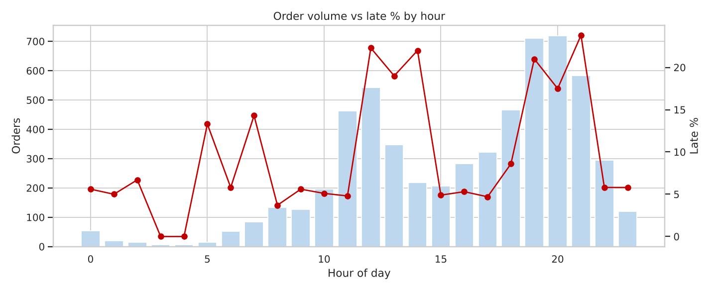
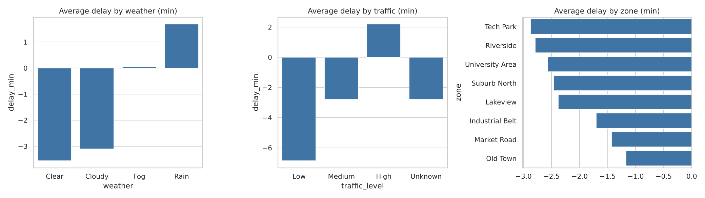
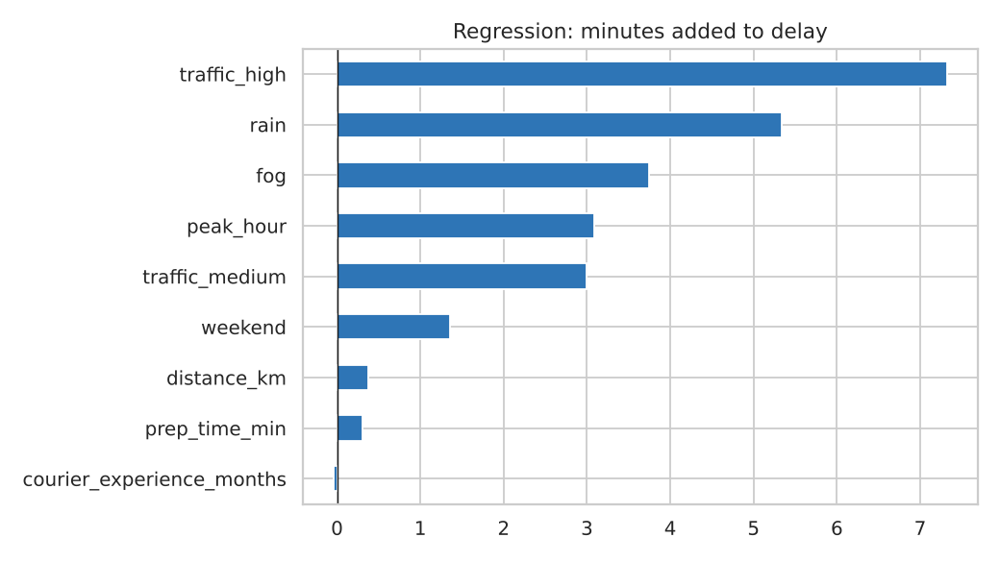

# Food Delivery Delay Analysis (Python)

> **Data note:** All data is **synthetic**, generated by `scripts/01_generate_data.py`. No real company or customer is represented. Findings describe this dataset and demonstrate the method.

## 1. Project Overview
A food delivery platform promises a delivery time to each customer. When the courier arrives more than 5 minutes after the promise, the order is **late**. This project uses Python (pandas, NumPy, Matplotlib, Seaborn, SciPy) to find out **when, where and why** deliveries are late and how lateness affects customer ratings.

## 2. Business Problem
Late deliveries lower ratings and repeat orders. Operations needs to know which conditions create delay so it can fix promises, staffing and zone plans.

## 3. Objectives
1. Clean 6,035 raw delivery records.
2. Measure on-time performance (late %, average delay).
3. Find how hour, weekday, weather, traffic, zone, distance, prep time and courier experience affect delay.
4. Test whether differences are real using statistics.
5. Measure how delay changes customer rating.
6. Find anomalies and give recommendations.

## 4. Tools and Technologies
Python 3, pandas, NumPy, Matplotlib, Seaborn, SciPy, Jupyter Notebook.

## 5. Dataset Information
| File | Rows | Description |
|---|---|---|
| `data/raw/raw_deliveries.csv` | 6,035 | Messy raw data: duplicates, case problems, missing values, impossible values |
| `data/cleaned/clean_deliveries.csv` | 5,985 | Cleaned data with new columns (delay, late flag, hour, weekday, peak hour, bands) |
| `data/cleaned/cleaning_log.csv` | - | Each cleaning step and rows affected |

Data dictionary: `docs/01_Project_Explained_Simple.md`.

## 6. Repository Structure
```
food-delivery-delay-analysis/
|-- README.md
|-- requirements.txt
|-- .gitignore
|-- data/raw/           raw_deliveries.csv
|-- data/cleaned/       clean_deliveries.csv, cleaning_log.csv
|-- scripts/            01_generate_data.py, 02_clean_data.py, 03_eda_analysis.py, 04_build_notebook.py
|-- notebooks/          Food_Delivery_EDA.ipynb
|-- visualizations/     8 charts (PNG)
|-- reports/            EDA_Report.md, Business_Insights_Report.md, results.json
`-- docs/               explanation, resume text, interview guide
```

## 7. Implementation Steps
1. Generate synthetic data with built-in quality problems.
2. Inspect: shape, types, missing values, duplicates, summary statistics.
3. Clean: remove duplicates, standardise text, convert dates, remove impossible values, handle missing values.
4. Create features: `delay_min`, `is_late`, `hour`, `day_of_week`, `is_peak_hour`, distance and experience bands.
5. EDA with 8 visualisations.
6. Statistical tests: t-test, ANOVA, chi-square, Pearson, Spearman, Mann-Whitney.
7. Multiple linear regression to rank factors.
8. Anomaly detection (IQR rule and z-score).
9. Business answers and recommendations.

## 8. Key Analysis
Late % by hour, weather, traffic, zone; weekday x time heatmap; distance/prep/experience effects; correlation matrix; regression effects; rating vs delay; outliers.

## 9. Important Findings (synthetic data)
- 5,985 clean orders; **13.7% late**; average delay -2.2 min (most orders arrive earlier than promised).
- **Traffic and weather are the biggest drivers.** Rain: 29.0% late vs 9.0% in clear weather. High traffic: 28.2% late vs 2.7% in low traffic. Rain + high traffic together: 57.2% late.
- Regression (R-squared 0.46): high traffic adds about 7.3 min, rain 5.3 min, fog 3.7 min, peak hour 3.1 min, weekend 1.4 min; each extra km only about 0.4 min.
- Peak hours (12-14 and 19-21): 20.8% late vs 5.9% off-peak. Worst hour: 21:00 (23.8%).
- Zone differences are real but small (Old Town 16.8% vs Riverside 10.8%).
- Late orders average a rating of **4.08** vs **4.63** for on-time orders; 15.1% of late orders get a rating of 3 or lower vs 1.8% of on-time orders.
- New couriers (0-6 months) are late 19.6% of the time vs 11.9% for couriers with over 24 months.

## 10. Business Recommendations
1. Make the promised time **weather- and traffic-aware** (add minutes when rain or high traffic is detected).
2. Add courier capacity at 12-14 and 19-21, especially on weekends.
3. Pair new couriers with easier routes and training in their first 6 months.
4. Review Old Town and Market Road routes and pick-up points.
5. Send a proactive delay message and small credit when an order is expected to be late (rating drop is large).

## 11. Screenshots
Charts are in `visualizations/`:




## 12. How to Run
```bash
pip install -r requirements.txt
python scripts/01_generate_data.py
python scripts/02_clean_data.py
python scripts/03_eda_analysis.py        # prints results, saves charts to visualizations/
python scripts/04_build_notebook.py      # optional: rebuilds the notebook
jupyter notebook notebooks/Food_Delivery_EDA.ipynb
```

## 13. Skills Demonstrated
pandas data cleaning, EDA, Seaborn/Matplotlib visualisation, hypothesis testing (t-test, ANOVA, chi-square), correlation, regression, outlier detection, business storytelling.

## Limitations
Synthetic data with planted patterns; only 3 months; no courier supply, GPS or restaurant data; 5-minute late threshold is an assumption; regression assumes straight-line effects and does not prove cause; ratings exist for 92% of orders only.
